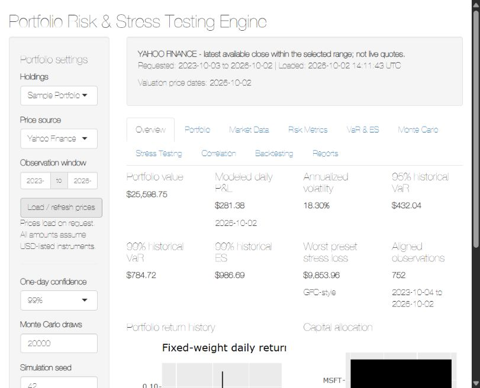

# Portfolio Risk & Stress Testing Engine

A modular R Shiny workbench for portfolio exposure, one-day market risk and scenario analysis. Built for quantitative risk interviews and learning, with manual risk formulas, explicit assumptions and reproducible tests.

## Quick start

Requires R 4.2 or newer (verified here with R 4.5.2).

```r
# Run from the project root:
source("scripts/install.R")
shiny::runApp()
```

Choose **Sample Portfolio**, select **Yahoo Finance**, choose a date range, then click **Load / refresh prices**. For an offline interview demonstration, explicitly select **Synthetic demonstration** and load. Generated prices are labeled throughout the dashboard and reports; failed Yahoo requests never trigger synthetic substitution.

CSV uploads support up to 50 unique holdings. Uploads and analytics remain in the local Shiny session; Yahoo requests contain the selected ticker symbols and date range. Changing holdings, dates or price source invalidates the loaded snapshot until refreshed.

## Features

- Validated sample/uploaded long-only Equity and ETF holdings, cost basis, price provenance, latest selected-range close valuation, allocation and concentration.
- Yahoo OHLCV downloads with per-ticker failures; adjusted simple/log returns aligned on common interval endpoints.
- Fixed-weight portfolio returns, daily statistics, geometric annualization and covariance-based volatility.
- Historical and normal parametric VaR; empirical conditional-tail and analytic normal Expected Shortfall.
- Reproducible correlated normal Monte Carlo with 10,000–200,000 configurable draws, including singular covariance support.
- Seven preset hypothetical stress scenarios, custom Equity/ETF shocks, class/holding contributions and equity-only up/down sensitivity.
- Interactive correlation heatmap, covariance table and Euler volatility contributions.
- Rolling historical VaR backtesting, exceptions and Kupiec coverage statistics.
- Ten dashboard sections using the default Shiny layout, default ggplot2 theme, Plotly charts and numeric DT tables.
- Self-contained HTML management reports, a PDF export path when TeX is configured, and valued-holdings CSV export.

## Screenshots

Capture the following views after selecting a data source and loading prices:

- Overview: value, tail-risk cards and historical return chart.
- VaR & ES: model comparison and lower-tail threshold.
- Stress Testing: scenario losses and holding contributions.
- Backtesting: exception chart and coverage summary.



The overview screenshot was verified with Yahoo data; the other views above are suggested screenshot additions. The included [sample HTML report](reports/sample-risk-report.html) uses deterministic synthetic data.

## Architecture

```text
app.R                         Minimal Shiny entry point
R/
  portfolio.R                 CSV validation, valuation and summary
  data_loader.R               Yahoo fetch and explicit synthetic mode
  returns.R                   Return alignment, aggregation and covariance
  var.R                       Historical/normal VaR and comparison
  expected_shortfall.R        Empirical and normal tail means
  monte_carlo.R               Correlated asset simulation
  stress_testing.R            Scenarios and equity sensitivity
  backtesting.R               Rolling forecasts and Kupiec test
  reporting.R                 Snapshot-based report export
  utils.R                     Validation, display and plot helpers
  dashboard_ui.R              Navigation and controls
  dashboard_state.R           Session reactives and data loading
  dashboard_outputs.R         Tables, charts and display wiring
data/sample_portfolio.csv
reports/risk_report.Rmd        R Markdown management report template
www/style.css                 Unused placeholder; standard Shiny styling
scripts/install.R             Dependency installation
scripts/verify.R              Syntax and unit checks
scripts/smoke.R               All-output server + HTML report check
scripts/check_pdf.R           Optional PDF integration check
tests/testthat/
```

Calculations stay separate from presentation. Market requests are event-driven; reusable results are reactive and cached per session. Monte Carlo temporarily scopes its seed with `withr`, without altering the caller's random stream. Reports copy their template to a unique temporary directory, preventing concurrent sessions from overwriting one another.

## Input format

```csv
Ticker,Quantity,PurchasePrice,AssetClass
AAPL,20,180,Equity
MSFT,15,410,Equity
GOOGL,10,170,Equity
SPY,10,550,ETF
```

Tickers are uppercased and text trimmed. Empty files, missing columns/values, duplicate normalized tickers, nonnumeric/nonfinite or nonpositive quantities/prices, and unsupported classes are rejected with readable messages. Asset classes are case-sensitive: `Equity` and `ETF`.

All prices are assumed USD. Use USD-listed instruments only: the application does not infer currency from Yahoo symbols or convert FX.

## Formulas and conventions

| Metric | Implementation |
|---|---|
| Position and portfolio value | Quantity × valuation price; sum across holdings |
| Weights | Position value / total value |
| Simple / log asset returns | P[t]/P[t−1] − 1; log(P[t]/P[t−1]) using vendor-adjusted close |
| Portfolio return | Sum of fixed valuation-date weight × simple asset return |
| Annualized return | exp(252 × mean(log(1 + portfolio return))) − 1 |
| Annualized volatility | Sample daily standard deviation × sqrt(252) |
| Matrix volatility | sqrt(w' × sample covariance × w) |
| Historical VaR | Negative empirical lower-tail quantile, R quantile type 7 |
| Normal VaR | −(mean + qnorm(1 − confidence) × standard deviation) |
| Historical / simulation ES | Negative mean of returns at or below the VaR return threshold, including ties |
| Normal ES | −mean + standard deviation × dnorm(qnorm(1−c))/(1−c) |
| Currency risk | Return risk × valuation-date portfolio value |
| Stress P&L | Sum of position value × assigned asset-class shock |
| Volatility contribution | w[i] × (covariance × w)[i] / portfolio volatility |
| Backtest exception | Next observed loss > preceding rolling-window VaR |

VaR is **not the maximum possible loss**. At 99% confidence, the model expects losses to exceed its one-day threshold about 1% of the time. Historical VaR imposes no normality assumption. Historical ES is a conditional empirical tail mean; with a discrete sample/ties it differs from a fractional-tail-mass estimator. Negative risk measures are retained rather than clamped.

The simulated asset return vector uses mean + covariance square root × independent normal shocks. An eigen decomposition supports positive semidefinite, singular covariance matrices. The Monte Carlo model and parametric model share normality assumptions; they are not independent tail-model evidence.

Kupiec H0: the exception probability equals 1−confidence. The likelihood-ratio statistic compares the null binomial likelihood with the fitted observed exception rate, and uses an asymptotic chi-squared distribution with one degree of freedom. Small p-values suggest incorrect coverage. The test does not check exception independence.

## Data and model limitations

- Valuation uses the latest valid **unadjusted close within the selected date range**, not a live quote or necessarily today's price. Dates and per-holding provenance are shown. PurchasePrice remains cost basis and is used only as an explicitly labeled fallback.
- Yahoo's adjusted close is vendor-supplied; dividend/split adjustment quality is not independently audited. See the [quantmod Yahoo implementation](https://github.com/cran/quantmod/blob/master/R/getSymbols.R).
- No holdings are silently dropped. Any missing ticker blocks portfolio analytics; successful assets remain viewable and valuation may use marked fallbacks.
- Return alignment checks both start/end dates, removes nonfinite observations, and never forward-fills. Non-synchronous calendars can reduce sample size.
- Current valuation weights are held fixed and assumed rebalanced daily over history. This introduces look-ahead in portfolio composition: the backtest is a diagnostic of today's portfolio, not an investable strategy. Each rolling VaR estimate itself uses preceding observations only.
- Daily P&L is last aligned portfolio return × current value, a modeled amount rather than reconciled accounting P&L.
- At least 30 aligned returns are required; even 30 is inadequate for reliable 99% tail inference. Prefer several years and inspect tail sample size and regime changes.
- Annualization assumes 252 sessions, stationarity and negligible serial dependence. Normal models can understate fat tails and simulate returns below −100%.
- Equity/ETF stress mappings are intentionally simplified. An ETF is treated as one class irrespective of underlying exposures. Interest-rate/FX/high-volatility labels are static repricing assumptions, not duration, currency or volatility-process models.
- GFC/COVID/EM scenarios are **historical-style hypothetical scenarios**, not historical replications.
- Concentration thresholds (30% moderate, 50% high) are application-defined.
- No leverage, short positions, derivatives, liquidity costs, taxes, authentication, market-data SLA, regulatory validation or multi-currency accounting is implemented.

## Reporting

Install RStudio (bundled Pandoc) or standalone Pandoc for HTML export. Windows RStudio's common bundled location is detected automatically; otherwise set `RSTUDIO_PANDOC` to its directory. Reports include holdings, provenance, metrics, all three VaR models/ES, scenario comparison, selected stress details, correlation/covariance, top volatility contributors, backtest results and charts.

PDF additionally needs a **fully configured** TeX installation (for example TinyTeX). A detected executable is not enough. This machine's MiKTeX executable reports incomplete initial setup, so PDF generation could not be verified here. The HTML report can also be printed to PDF in a browser.

## Tests and verification

```sh
Rscript scripts/verify.R
Rscript scripts/smoke.R
# Optional, with configured TeX:
Rscript scripts/check_pdf.R
```

The unit suite covers normalization, all requested invalid inputs, fetch failure, valuation, return interval alignment, weighting, covariance agreement, VaR/ES, deterministic Monte Carlo, stress and sensitivity, no-look-ahead rolling forecasts and zero-exception Kupiec boundaries. The smoke script renders all 31 analytic/display outputs, builds a synthetic HTML report and checks stale-input rejection.

Verified locally: R syntax, 53 unit assertions, all server outputs, HTML report generation, and browser dashboard operation with synthetic data and successful Yahoo downloads for all four sample holdings (751 aligned returns). PDF is conditional on completing the existing TeX setup. Yahoo availability is an external dependency and can fail or throttle; every failure is surfaced.

Required packages: shiny, bslib, ggplot2, dplyr, tidyr, lubridate, quantmod, xts, zoo, DT, plotly, scales, withr, rmarkdown, knitr and testthat. `scripts/install.R` installs only missing packages. A lockfile is not supplied; capture one with renv when establishing your deployment environment.

## Resume-ready description

**Portfolio Risk & Stress Testing Engine**  
R, Shiny, ggplot2, Monte Carlo Simulation, Financial Risk

- Developed an interactive R Shiny portfolio analytics platform implementing Historical, Parametric and correlated Monte Carlo VaR, Expected Shortfall, volatility and correlation-based risk metrics.
- Implemented configurable hypothetical stress testing, rolling VaR coverage backtesting and automated management reports to analyze portfolio exposures and tail-risk behavior.

## Future improvements

Historical scenario replay, robust/t-distribution return models, independent coverage testing, position-history backtesting, audited market-data ingestion, FX conversion, authentication and deployment observability. Bond duration and option Greeks require dedicated instrument models and are deliberately outside this version.


